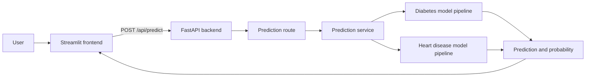

# Dr. ML - Multi-Disease Predictor


A full-stack machine learning project for predicting multiple diseases using trained models, a FastAPI backend, and a Streamlit frontend. The application supports diabetes risk prediction and heart disease risk prediction from patient health parameters.

## Overview

This project combines:
- Machine learning pipelines for disease prediction
- FastAPI backend APIs for model inference
- Streamlit-based user interfaces for clinician-friendly input
- Preprocessing utilities, dataset handling, and model training scripts
- Exported project documentation in PDF format

The solution is structured to separate concerns across frontend, backend, training, and common utility modules, making it easy to extend with more disease prediction models later.

## Features

- Diabetes prediction using clinical features such as glucose, BMI, insulin, age, and diabetes pedigree function
- Heart disease prediction using parameters including age, sex, chest pain type, resting blood pressure, cholesterol, and more
- Interactive frontend for entering patient values and viewing model results
- REST API for prediction requests
- Training scripts for generating and saving model artifacts
- Configurable environment and hyperparameter settings
- PDF walkthrough generation for project documentation

## How It Works



The frontend submits the selected disease and its input features to the API. The backend selects the corresponding trained pipeline and returns the predicted class and probability to display in the app.

## Screenshots

The Streamlit app includes a home page with navigation to the diabetes and heart disease prediction forms. Start the frontend using the command below to view the live interface locally. Screenshots can be added here as the UI evolves.

```bash
streamlit run src/frontend/app.py
```

## Tech Stack

- Python
- FastAPI
- Streamlit
- scikit-learn
- pandas
- NumPy
- joblib
- XGBoost
- PyYAML
- Pydantic and Pydantic Settings
- ReportLab (for PDF generation)

## Project Structure

```text
ML-Dr-ml-multi-disease-predictor/
├── README.md
├── requirements.txt
├── env_template.txt
├── check.py
├── log/
│   └── app.log
├── model_dir/
│   ├── diabetes_prediction_pipeline.joblib
│   └── heart_disease_prediction_pipeline.joblib
├── notebook_dir/
│   ├── 1_diabetes_prediction_using_ml.ipynb
│   └── 2_heart_disease_prediction_with_ml.ipynb
├── docs/
│   └── project_walkthrough.pdf
├── scripts/
│   ├── __init__.py
│   └── generate_project_walkthrough.py
├── src/
│   ├── Backend/
│   │   ├── main.py
│   │   ├── Api/
│   │   │   ├── __init__.py
│   │   │   └── routes.py
│   │   ├── config/
│   │   │   ├── Settings.py
│   │   │   └── __init__.py
│   │   ├── schemas/
│   │   │   ├── __init__.py
│   │   │   └── prediction_schema.py
│   │   └── services/
│   │       ├── __init__.py
│   │       └── predictor.py
│   ├── Common/
│   │   └── preprocessing_util.py
│   ├── frontend/
│   │   ├── app.py
│   │   ├── config/
│   │   │   ├── __init__.py
│   │   │   └── settings.py
│   │   └── pages/
│   │       ├── diabetes_prediction.py
│   │       └── heart_disease_prediction.py
│   └── training/
│       ├── diabetes.py
│       ├── heart_disease.py
│       ├── config/
│       │   ├── __init__.py
│       │   ├── best_hyperparams.yaml
│       │   └── settings.py
```

## Backend

The backend is built with FastAPI and is responsible for:
- Serving health checks
- Receiving prediction requests
- Loading the correct trained model based on disease type
- Returning prediction results with probability scores

Main backend file:
- `src/Backend/main.py`

API routes:
- `src/Backend/Api/routes.py`

Prediction schema:
- `src/Backend/schemas/prediction_schema.py`

Prediction service:
- `src/Backend/services/predictor.py`

## Frontend

The frontend is built with Streamlit and provides two prediction pages:
- Diabetes predictor
- Heart disease predictor

Entry point:
- `src/frontend/app.py`

Pages:
- `src/frontend/pages/diabetes_prediction.py`
- `src/frontend/pages/heart_disease_prediction.py`

## Model Training

Training scripts are stored under `src/training`:
- `src/training/diabetes.py`
- `src/training/heart_disease.py`

These scripts:
- load datasets
- perform preprocessing
- train the relevant models
- evaluate metrics such as accuracy, recall, and F1-score
- save the trained pipeline artifacts to `model_dir/`

Hyperparameter configuration is stored in:
- `src/training/config/best_hyperparams.yaml`

## Environment Configuration

Use the template file `env_template.txt` as a reference to create your own `.env` file.

Example environment values include:
- `LOG_PATH`
- `DIABETES_DATASET_PATH`
- `HEART_DISEASE_DATASET_PATH`
- `DIABETES_MODEL_PATH`
- `HEART_DISEASE_MODEL_PATH`
- `DIABETES_TARGET_COL`
- `HEART_DISEASE_TARGET_COL`
- `HYPER_PARAMS_YAML_PATH`
- `TEST_SIZE`
- `RANDOM_STATE`
- `API_URL`

For Streamlit Community Cloud, add the backend prediction endpoint in the
app's **Settings → Secrets**:

```toml
API_URL = "https://<your-backend-host>/api/predict"
```

Deploy the FastAPI backend separately and use its public HTTPS address. Do not
use `localhost` or `127.0.0.1` for a cloud deployment. Locally, the same
`API_URL` setting can be placed in `.env`.

## Setup Instructions

1. Clone the repository
2. Create a virtual environment if needed
3. Install dependencies:

```bash
pip install -r requirements.txt
```

4. Copy the environment template and configure `.env` with your local paths and settings:

```bash
copy env_template.txt .env
```

5. Ensure the dataset files and model artifacts exist in the configured paths.

## Run the Project

### Start the backend

```bash
uvicorn src.Backend.main:app --reload
```

### Start the frontend

```bash
streamlit run src/frontend/app.py
```

Then open the Streamlit URL in the browser and use the app to input patient data for prediction.

## API Usage

The backend exposes a prediction endpoint:

```http
POST /api/predict
```

Example request body:

```json
{
  "disease": "diabetes",
  "features": {
    "Pregnancies": 2,
    "Glucose": 120,
    "BloodPressure": 70,
    "SkinThickness": 25,
    "Insulin": 80,
    "BMI": 28.5,
    "DiabetesPedigreeFunction": 0.45,
    "Age": 35
  }
}
```

Example response:

```json
{
  "disease": "diabetes",
  "prediction": 0,
  "probability": 0.32132370710283475
}
```

## Project Documentation

A walkthrough PDF is generated in the `docs/` folder:

- `docs/project_walkthrough.pdf`

This can be used for project onboarding, review, or stakeholder presentation.

## Notes

This project is designed to be easily expanded. New disease modules can be added by following the same pattern as the existing diabetes and heart disease prediction pipelines.

## License

This project is intended for educational and demonstration purposes.
